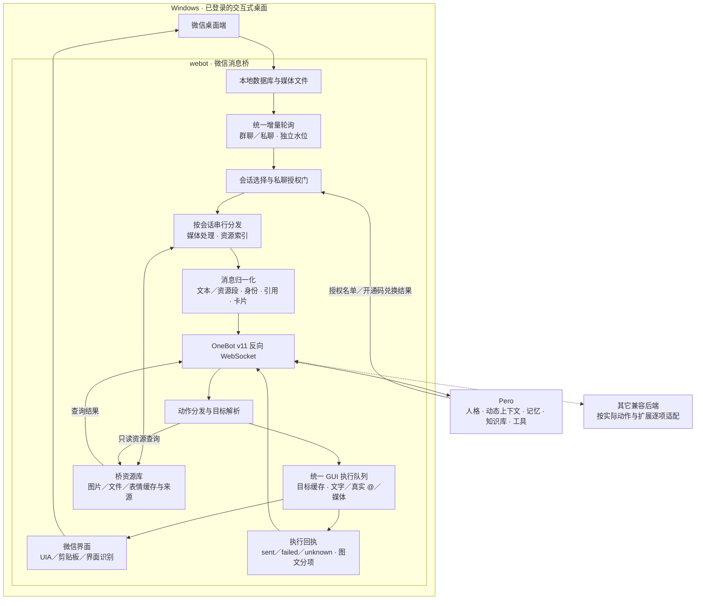

# webot

首次克隆后，先双击 `install.cmd` 安装相邻 Pero 的后端和前端、以及本仓库的微信桥依赖，再配置微信目录并绑定账号。只缺 Pero 环境时可单独运行相邻 Pero 根目录的 `install-pero.cmd`。

**Windows 本机部署从这里开始：[完整安装、账号绑定、全群接入和组合启动](docs/deployment-windows.md)。组合由 webot 管理，Pero 不再提供微信组合入口。**

**连接微信与 Agent。**

webot 是面向 Windows 微信桌面端的消息桥。它通过本地数据库增量读取消息，通过桌面界面执行发送，并以 OneBot v11 事件和动作连接上层应用。

群聊与私聊、文字与资源、微信身份与协议标识、执行与回执在桥内分别处理。上层应用负责决定如何回应，webot 负责将消息送达，并报告实际执行结果。

当前配套 Agent 为 [Pero](https://github.com/3523509051/Pero)。Pero 提供人格、动态上下文、分层记忆、知识库、工具和控制室；webot 提供微信接入，不要求把这些能力再实现一遍。

> **源码预览**：桥运行在 Windows 已登录的微信桌面会话中，读取与发送依赖客户端及底层库兼容性。当前以实际部署验证过的组合为依据，不承诺所有微信 4.x 版本均可运行。它不是微信官方提供的接入接口。

[核心能力](#核心能力) · [项目工程图](#项目工程图) · [群聊与私聊](#群聊与私聊) · [图片表情与文件](#图片表情与文件) · [发送与回执](#发送与回执) · [接入契约](#接入契约) · [快速开始](#快速开始) · [文档与开发](#文档与开发)

## 核心能力

| 能力 | 说明 |
| --- | --- |
| 增量读取 | 按会话水位读取新消息，启动时对齐基线，避免把旧聊天当成本轮新输入 |
| 群聊与私聊 | 群聊按配置选择；配合 Pero 同步私聊授权和处理开通码 |
| 统一调度 | 群聊与私聊复用增量轮询与会话分发结构，各自保留水位和队列 |
| 身份与引用 | 维护桥内 ID、微信身份及消息来源映射，提取可获得的引用和链接卡片信息 |
| 图片与表情 | 获取可用图片、缓存及引用资源，通过版本化媒体动作发送图片或表情 |
| 文件接入 | 收集可获取的文件原件与元数据，提供受控整块或分块查询 |
| 发送结果 | 区分确认发送、明确失败与结果未知；图文批次保留分项回执 |
| 平台连接 | OneBot v11 反向 WebSocket、心跳、重连及按原请求 echo 回应动作 |

webot 不负责判断何时加入对话，不保存 Pero 的分层记忆，也不自行观看视频或调用模型理解文件。B站观看、知识检索和人格等能力属于上层 Agent 或其插件。

## 项目工程图



读取与分发分开，某个会话的媒体处理不必阻塞其它会话的数据库读取；GUI 发送则统一串行，避免多个动作同时操作微信窗口。图中的双向关系表示交互，不表示共享同一数据库。

更细的事件、动作和回执说明见 [桥接契约](docs/bridge-integration.md)。

## 群聊与私聊

### 群聊

使用 `wechat.groups` 显式配置微信原始群 ID 与界面显示名称，也可使用群名／ID 白名单筛选。桥按会话读取和上报新消息，是否回应由上层的路由、唤醒与参与策略决定。

**监听范围和回复范围是两层配置。** 桥能读取某个群，不表示 Pero 已允许该群调用模型或自动发送。群改名后应同步界面名称；相同昵称也不能替代稳定身份。

### 私聊

当前私聊授权与 Pero 联动：

1. 在 Pero 控制室生成指定机器人账号的一次性开通码。
2. 联系人在与该机器人账号的微信私聊中发送完整开通码。
3. 桥识别兑换请求，携带可信身份交给 Pero 处理。
4. 桥同步有效授权名单，对已授权联系人开始常规私聊增量读取与分发。
5. 暂停或撤销授权后，桥按同步结果限制读取目标和投递。

未授权会话只进入开通码发现所需的有限流程，不作为普通聊天持续交给 Agent；这不等于桥从不读取这些会话的任何消息。开通码发现和授权名单同步使用各自周期，新授权不保证瞬时出现在下一轮。

授权同步失败与成功取得空名单分开处理：暂时不可验证时暂停投递并保留待处理状态；明确撤销时移除相应目标及待分发事件。私聊也有启动时间和水位边界，不自动回放旧对话。

主人绑定、授权转移及主人跨群读取范围由 **Pero** 管理。操作方式见 [Pero 的私聊授权与主人说明](https://github.com/3523509051/Pero#私聊授权与主人)。仅更改桥的联系人备注不能设置主人。

## 身份、引用与链接卡片

微信原始 ID、桥映射的数字 ID 和界面显示名各有用途。

| 标识 | 用途 |
| --- | --- |
| 微信原始群 ID／用户 wxid | 与微信数据、联系人及资源来源对齐 |
| 桥内数字 ID | 在 OneBot 事件、动作与上层路由中表示账号或目标 |
| 昵称／群名／备注 | 界面展示、会话定位及可获得的别名信息，不作为跨平台身份合并依据 |
| 桥消息 ID 与 session | 关联本次桥运行中的消息和身份查询 |
| local_id／seq 等来源字段 | 在可获得时定位微信本地消息与读取水位 |

桥映射的数字群号不是微信 wxid，也不是 QQ 号；消息 ID 的唯一性范围也不能直接当成平台永久消息 ID。引用中的作者、文字、时间和图片线索只有取得时才提供，缺失时保留未知。

链接卡片会提取实际可获得的标题、说明、URL 和引用信息。桥传递链接，不等于模型已经访问了链接内容；例如 B站视频仍需 Pero 的观看插件执行读取和分析。

入站 @ 线索与出站真实 @ 是不同能力。入站存在按昵称匹配的情形，上层不应一律当作平台级可信提及；出站真实 @ 依赖成员名称匹配和微信界面的选择执行。

## 图片、表情与文件

### 图片与引用原图

收到的可用图片可转换为受控消息段，并缓存来源索引。引用图片按当前会话的消息线索查找；找不到原件时返回相应状态，不拿另一张图代替。

图片是否实际进入模型，由上层的图片开关、上下文策略和工具决定。桥能取得图片不等于已经识别图片内容。

### 表情与媒体发送

桥可获取可用的表情原件或静态帧，并执行 Pero 下发的媒体动作。表情收录、命名、检索和会话隔离策略由 Pero 管理；桥保留自己的兼容资源能力，两者不是同一个记忆库。

`pero_media_send_v1` 支持文字与单图，`pero_media_send_v2` 支持文字与多图批次，当前单批最多六张图片。文字和图片分别记录结果，前项失败或不确定时停止后续发送，不盲目重发。私聊和群聊共享底层发送设施，但目标解析与授权条件各自校验。

### 文件接入

可获取的会话文件保存到桥资源库，按会话和文件编号提供元数据及字节查询。整块与分块读取分别有大小和范围校验；分块查询不要求一次把整个文件放进消息帧。

桥的主要职责是取到原件并证明来源。PDF、Office 等内容如何解析、是否使用 Files API、如何建立知识索引，由 Pero 或其它上层应用决定。文件名、占位消息或成功接收附件不能当作“已经读完文件”。

**当前 README 不将文件发送、语音发送或完整语音识别列为已支持能力。** 收到语音、视频等消息时，可能仅有类型占位或有限元数据，具体以实际事件为准。

## 发送与回执

webot 通过 Windows 微信界面完成发送。目标会话已得到有效确认时可复用缓存，切换目标或缓存失效后重新定位；缓存用于减少重复查找，不绕过账号和目标校验。

| 状态 | 意义 | 上层应如何处理 |
| --- | --- | --- |
| `sent` | 底层按当前确认机制报告发送成功 | 才可作为已发言记录；不等于对方已读 |
| `failed` | 已得到明确失败信息 | 显示失败及原因，不冒充送达 |
| `unknown` | 已尝试或连接中断等情况下无法确认结果 | 保留不确定状态，不自动重复发送 |

普通消息使用对应 `echo` 回应动作；媒体扩展还提供文字、逐张图片及整批状态。整批成功字段不能代替每一项的事实。

`wechat.verify_send` 控制适用路径的发送后回读验证，可能增加等待时间；它不是所有消息都能验证成功的保证。发送完成与对方阅读是不同概念。

**入站上报重试与出站重发也不同。** 会话分发队列可在反向连接失败时保留并重试上报；GUI 发送结果不确定时不会因此再发一遍。当前队列主要在进程内，不承诺桥重启后的持久消息补偿或端到端严格恰好一次。

## 接入契约

webot 主动连接上层的 OneBot v11 反向 WebSocket 服务，握手提供 `X-Self-ID`、`X-Client-Role`，配置 token 时附带 Bearer 认证。事件包含群聊／私聊、消息段、发送者及时间；动作响应保留原始 `echo`。

| 类别 | 当前代表接口／字段 |
| --- | --- |
| 状态与群目录 | `get_login_info`、`get_version_info`、`get_status`、`get_group_list` |
| 身份查询 | `get_group_member_list`、`get_identity_directory`、`get_message_identity` |
| 文本发送 | `send_group_msg`、`send_private_msg`、相应 `send_msg` 分支 |
| 媒体发送扩展 | `pero_media_send_v1`、`pero_media_send_v2` |
| 文件查询扩展 | `pero_file_bytes_v1`、`pero_file_chunk_v1` |
| 引用图片扩展 | `pero_quote_image_v1` |
| 可信来源扩展 | 事件顶层 `pero_ext` v1 中实际可获得的身份、引用和文件信息 |

这是 **OneBot v11 的部分实现及额外扩展**，不是完整标准实现。不能据“兼容 OneBot”假设任意 image、file、record 消息段都能按普通发送动作直接发送。未适配的发送动作明确失败；转发消息兼容路径会将文本展开为普通长消息，不生成微信原生合并转发卡片。

其它后端可对照 [桥接契约](docs/bridge-integration.md) 接入基础能力。当前私聊发现、兑换与授权同步依赖 Pero 的内部接口；其它后端若需要私聊，还须提供相应授权适配。

## 快速开始

### 与 Pero 自动组合启动

安装双方依赖、构建 Pero 前端后，手动登录机器人微信，先运行 `绑定微信账号.cmd`，再从 webot 运行 `start.cmd`。并列目录自动找到 Pero；否则使用 `start.cmd --pero-root "D:\你的目录\Pero"`。

启动时自动扫描并接入机器人账号的全部群，不提供首次选群步骤。通过机器人入群或退群控制范围；当前需停止并重新启动组合后同步群列表。回复仍遵循唤醒与群规则。

组合启动会修改 bridge/config.json 并先备份原文件。当前桥支持 astrbot.token_env 从进程环境读取连接令牌，组合入口负责加密保存与注入。详细步骤见 [Pero 微信组合使用指南](https://github.com/3523509051/Pero/blob/main/docs/wechat-combination.md)。下方供单独运行桥使用。

### 1. 运行条件

| 项目 | 要求 |
| --- | --- |
| 系统 | Windows 10／11 的交互式用户桌面 |
| Python | 64 位 Python 3.10+；建议以实际验证环境 Python 3.11 为起点 |
| 微信 | 已登录并持续运行的兼容微信 4.x 桌面客户端；仓库历史使用过 4.1.12／4.1.15 系列，不据此承诺全部版本兼容 |
| 上层后端 | 已配置的 Pero，或已逐项适配的 OneBot v11 服务端 |
| 桌面状态 | 发送时能操作目标窗口；锁屏、桌面切换、缩放及窗口遮挡均可能影响执行 |

微信桥本身运行在 Windows 宿主机，不是把它放入 Linux 容器就能操作微信界面。上层服务可以单独部署，只要网络、身份和资源契约匹配。

### 2. 安装

```powershell
git clone https://github.com/3523509051/webot.git
cd webot\bridge

python -m venv .venv
.\.venv\Scripts\python.exe -m pip install -r requirements.txt
Copy-Item config.example.json config.json
```

`config.json` 是本机运行配置，已被 Git 忽略。依赖目前未全部固定版本，首次安装与依赖升级都应在实际微信环境验证。网页辅助动作如需 Playwright／Edge，应另行配置浏览器；基础消息桥不要求启动这些辅助动作。

### 3. 配置连接与监听群

编辑 `bridge/config.json`。以下片段展示与 Pero 对接的关键项；将占位符替换为真实配置，保留其它需要的模板字段：

```json
{
  "astrbot": {
    "ws_url": "ws://127.0.0.1:6200/ws",
    "token": "<与 Pero 的 OneBot 连接令牌一致>",
    "self_id": 10001,
    "heartbeat_seconds": 15
  },
  "wechat": {
    "bot_nickname": "Pero",
    "groups": {
      "<真实群wxid@chatroom>": "<微信界面显示的群名称>"
    },
    "poll_interval": 1.5,
    "rhythm": "fast"
  },
  "private_chat": {
    "pero_url": "http://127.0.0.1:8765",
    "token_env": "PERO_MANAGEMENT_TOKEN",
    "sync_seconds": 5.0,
    "discover_seconds": 15.0
  }
}
```

**`astrbot` 是当前沿用的配置节名称，不意味着必须使用 AstrBot。** `ws_url` 应填写实际后端地址。模板的 `6199` 来自旧组合；Pero 通道默认配置端口为 `6200`，需显式开启并核对监听地址，不能仅照抄某个端口。

首次运行建议显式填写 `wechat.groups`。当前逻辑在 `groups` 和 `group_whitelist` 都为空时会尝试枚举全部群，**空列表不表示不监听任何群**。桥也仍要求至少一个可用群才能完成当前启动流程，尚不能按“零群、纯私聊”配置直接启动。

### 4. 与 Pero 对齐

- 在 Pero 启用 OneBot 通道，确认桥的 WS URL 与通道端口／路径一致。
- `astrbot.self_id` 对齐 Pero 的账号路由。它是桥协议账号标识，不是某位联系人的微信号。
- 桥的 `astrbot.token` 对齐 Pero `PERO_ONEBOT_TOKEN` 指定的连接令牌；是否校验取决于 Pero 实际配置。
- 将桥内数字群 ID 配置到 Pero 的群路由、允许会话和自动发送目标。可从事件、`get_group_list` 或身份目录核对，不能把群 wxid 直接填入数字目标字段。
- 需要自动回应时，再在 Pero 显式开启相应处理／发送开关和模型配置；桥连接成功不表示模型已配置。

需要私聊时，在启动桥的同一个 PowerShell 设置与 Pero 内部接口一致的管理访问码：

```powershell
$env:PERO_MANAGEMENT_TOKEN = '<与 Pero 管理服务一致的管理访问码>'
```

OneBot 连接令牌、内部管理访问码和模型 API Key 是不同凭据。webot 的正常消息桥接不需要保存模型 API Key；模型凭据由 Pero 管理。

### 5. 启动与检查

确认微信已登录、后端已启动，在 `bridge` 目录执行：

```powershell
.\.venv\Scripts\python.exe main.py
```

检查微信初始化、监听群、水位基线和反向连接状态。部分日志仍使用“AstrBot”字样，判断连接对象应以实际 `ws_url` 为准。

可以按需运行以下本地诊断：

```powershell
.\.venv\Scripts\python.exe probe_db.py
.\.venv\Scripts\python.exe introspect.py
```

这些诊断可能输出本机路径、群名或消息字段，分享前请脱敏。`introspect.py` 用于本机核对，不能把其输出直接当成适合公开的日志。

首次联调建议先在测试群核对一条入站文字和一条出站回复，再验证引用、图片、表情、文件和私聊。新版本微信或底层依赖升级后，应重新核对这些实际路径。

## 常用配置

| 配置项 | 作用 |
| --- | --- |
| `astrbot.ws_url`／`self_id`／`token` | 上层反向连接地址、桥账号和传输认证 |
| `wechat.groups` | 原始群 ID 到微信界面群名的显式映射，优先于枚举筛选 |
| `wechat.group_whitelist` | 没有显式 groups 时按群名或群 ID 筛选；空值会放开该筛选 |
| `wechat.bot_nickname`／`bot_nicknames` | 补充 @ 识别别名；不替代 Pero 的自定义唤醒词配置 |
| `wechat.db_dir` | 微信数据库目录；特殊路径或 OneDrive 重定向时显式指定 |
| `wechat.poll_interval`／`read_batch` | 统一读取周期与每批读取数量，需结合会话数及设备负载调整 |
| `wechat.dispatch_queue_max` | 会话分发队列容量；队列不是跨重启的消息日志 |
| `wechat.verify_send` | 适用发送路径的额外回读确认开关 |
| `wechat.rhythm` | 底层界面操作节奏，不决定模型回复频率 |
| `wechat.send_images`／`fetch_stickers` | 图片输入及表情获取相关开关 |
| `wechat.image_max_bytes`／`image_max_edge` | 图片输入字节预算及尺寸处理 |
| `wechat.image_cache_keep` | 图片缓存保留策略；当前 `-1` 表示不自动裁剪，`0` 关闭 |
| `private_chat.*` | Pero 私聊授权接口、令牌环境变量、同步及发现周期 |
| `logging.*` | 桥及底层库的日志级别；排查后可恢复正常级别 |

部分默认值在 `main.py` 的 `DEFAULT_CONFIG` 中补齐，模板未逐项列出不代表该项不能配置。配置修改后应重启桥并确认实际读取结果。

## 运行与数据

- **保持交互桌面**：锁屏与普通熄屏不是同一种状态。仓库的虚拟显示／熄屏方案依赖额外驱动、脚本和当前桌面配置，不作为任意 Windows 机器的通用保证。
- **只运行需要的实例**：同一微信窗口不应由多个桥进程同时操作。Python 虚拟环境启动器可能带子进程，不能仅按进程数量判断重复实例。
- **保留实际资源边界**：桥缓存用于资源查找和执行，不是上层长期记忆；删除文件缓存可能影响以后引用原件。
- **控制记录范围**：聊天资源、身份目录、微信密钥及运行配置属于本机数据，不随公开仓库提供。备份、日志分享和目录清理应分别处理。
- **升级有兼容成本**：微信布局、数据库格式及底层依赖变化都可能影响读取或发送；先验证后替换长期运行环境。

### 旧 AstrBot 组合

仓库仍保留旧插件、Docker Compose 及 `start.cmd`、`restart-all.cmd`、`restart-astr.cmd` 等运维入口。它们面向原 AstrBot 组合，不是 Pero 的通用启动器；`scripts/webot-service.ps1` 当前仍包含 Docker／AstrBot 服务控制。

使用 Pero 时，优先使用 **webot 仓库的 start.cmd**，或分别启动 Pero 和 bridge/main.py。webot 根目录的 start.cmd/stop.cmd/status.cmd 现统一管理 Pero 组合；旧 AstrBot 脚本仅作历史兼容。旧资料保留用于历史参考，当前桥能力以本文及源码为准。

## 文档与开发

| 入口 | 内容 |
| --- | --- |
| [桥接契约](docs/bridge-integration.md) | 连接、事件、身份、动作、资源查询及回执 |
| [桥目录](bridge/README.md) | 当前运行入口与主要源码导航 |
| [Pero](https://github.com/3523509051/Pero) | 配套 Agent、控制室、记忆、知识库和私聊／主人设置 |
| [B站插件](https://github.com/3523509051/Pero-bilibili) | 上层插件示例；视频处理不由桥自行执行 |

```text
bridge/
  main.py                   装配、资源事件转换与动作分发
  onebot11.py               反向连接、事件与 echo 响应
  wechat_client.py          数据读取、目标定位、文字与媒体发送
  unified_poll.py           群聊／私聊统一轮询及会话队列
  private_gate.py           私聊授权目标、水位与投递闸门
  private_chat_handler.py   Pero 授权同步与开通码兑换
  identity_directory.py     微信身份、别名和消息来源映射
  file_library.py           桥文件原件及元数据
  sticker_library.py        兼容表情资源库
  paths.py                  本地数据目录定位
  send_result.py            发送结果语义
  config.example.json       可公开配置示例
docs/                       当前契约及历史设计资料
scripts/                    运维与可选桌面辅助脚本
plugins/                    旧 AstrBot 组合的插件
```

提交问题时请说明 Windows、微信、Python、底层依赖及上层后端版本，提供可复现步骤和脱敏错误信息。优先区分“没有读到”“没有上报”“后端未回应”“发送失败”和“已尝试但结果未知”，不要把所有情况都归为模型故障。

## 许可与使用范围

webot 主仓库采用 [MIT License](LICENSE)。底层依赖、第三方资源及上层 Agent／插件分别遵循各自许可和使用条件。

本项目通过本地数据访问与桌面自动化接入个人微信。请仅处理自己有权访问的数据，并按实际场景控制监听、发送及资源保留范围；不提供微信官方支持、账号可用性或免受平台限制的保证。

本文依据当前源码整理，干净目录安装与最终公开发布范围仍需按发布清单验证；不把某台长期运行设备的配置当成所有用户都可直接复用的默认环境。
