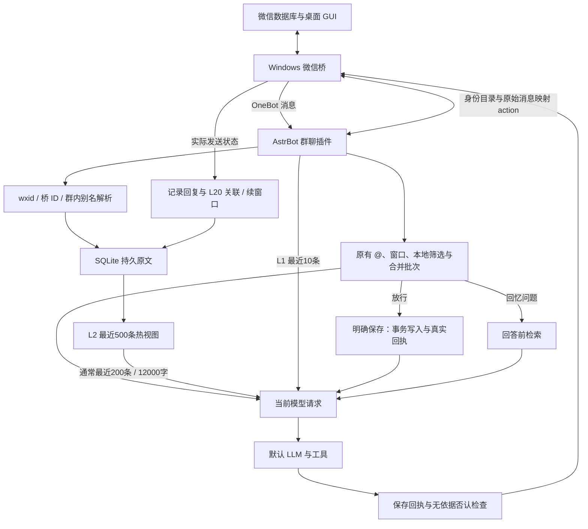
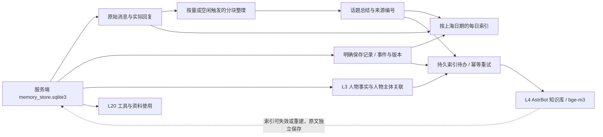
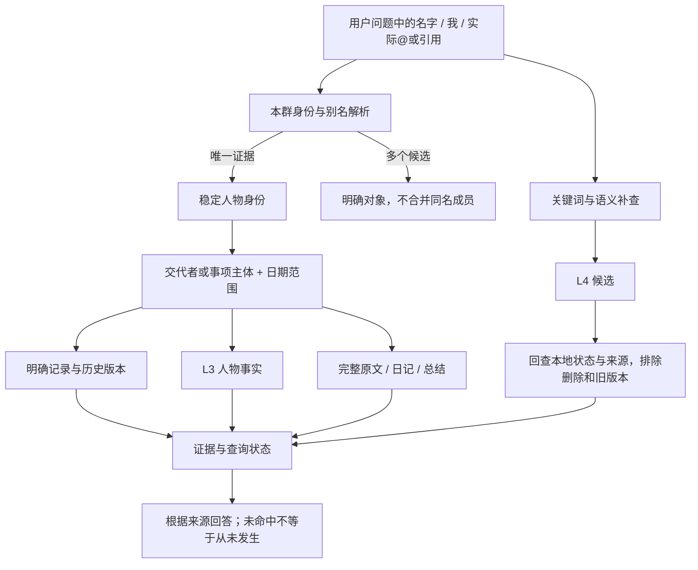
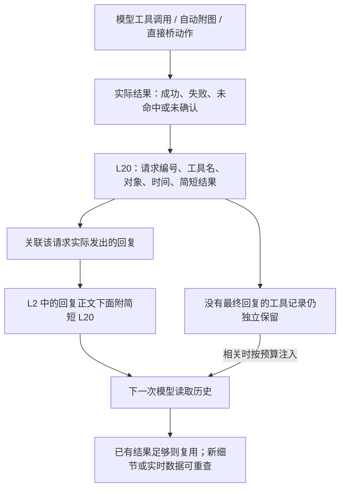

# v0.21.0 当前记忆工程图

2026-11-14 实施。运行检查以 [升级进度](memory-upgrade-progress.md) 为准；用法见 [升级说明](upgrade-v0.21.0.md)。

## 1. 从微信到回答

群聊窗口与是否记原文分离。明确保存发生在已经放行给机器人的对话中，不将旁观闲聊擅自当保存命令。

## 2. 可靠记录与派生索引

原文、事项、画像、总结和 L20 均落盘。L2.5 是整理过程；不再靠队列超过 500 条触发。摘要失败不删除来源，索引失败保留待办。物理清理目前关闭。

## 3. 人物身份与查询

已用真实数据验证 Amy 与陈sir可以指向同一 wxid，另一个名字相近的成员保持独立。旧聊天身份仅在原始文本、时间与发送者证据不冲突时回填，无法确认的部分继续保留未解析状态。

## 4. L20 如何接在回复下方

图片记录包含群内编号、已有文件名或稳定图像标识及真实返回状态。文件记录包含名称、内容版本、范围和截断状态。目录查询不记为已读取。L20 不向微信群额外发送，也不反复注入图片 base64 或完整工具结果。

## 5. 与旧文件及贝蒂的边界

旧 JSONL、L3 JSON 和原有 L4 在迁移期间保留。新系统生成的索引文档不会再次当作旧资料导入；清除和取消通过本地状态与任务版本阻止旧结果重新出现。

贝蒂插件本次未修改。它原有的转达成功写回 L1 行为没有升级为新库写入；这部分仍按用户要求留待后续单独处理。
