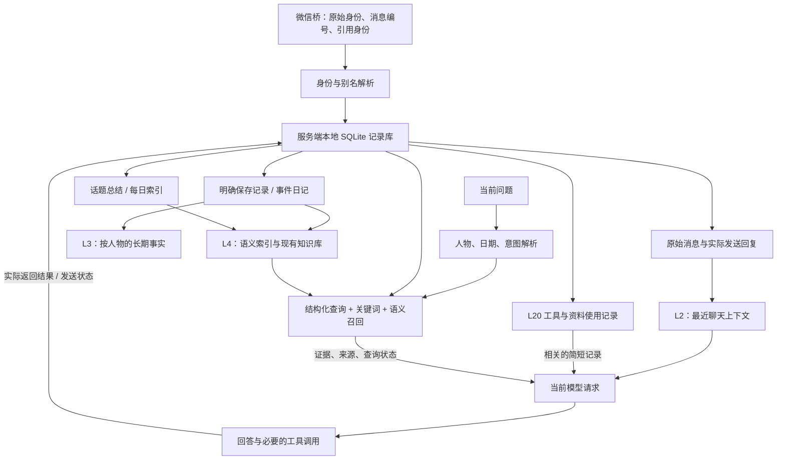

# webot 记忆系统升级执行方案

**状态：用户已于 2026-11-14 批准执行。实现与部署结果见 [执行进度](memory-upgrade-progress.md)。**

> 最新收尾范围：用户明确取消后续自动测试与旧记录恢复验收，以主体功能上线、后续实机反馈为准。下文保留原方案作为设计参考；不据此宣称所有原定故障恢复与极端场景均已交付。

编写日期：2026-11-14，时区 Asia/Shanghai。适用基线：群聊插件 v0.20.1，现有微信桥与 AstrBot 部署。

下文保留获批方案，描述实施目标与验收标准；实际状态以执行进度和升级报告为准。实施按本文件阶段逐项推进，使用 `superpowers:executing-plans` 跟踪，未并行委派任务。

## 1. 要达到的结果

升级后，群友明确说“记住这件事”，系统先可靠保存，再依据真实结果确认；隔天换一种问法、成员改名或上下文超过 500 条，仍能通过人物、时间和内容查到来源。机器人还应知道上一轮调用过哪些工具、哪些图片实际返回过，避免跨轮遗忘工具使用情况。

沿用现有 AstrBot、微信桥、默认人格和群聊路由。新增一个可靠本地记录库，衔接已有 L3 与 L4；不新起记忆服务，不新增独立日记插件，不处理贝蒂联动。

### 本次纳入的工作

1. 统一微信原始 ID、桥 ID、成员名字和群内别名。
2. 将完整原文保存与 L2 上下文窗口分开，修复旧流水归档链路。
3. 建立用户明确要求保存的记录及真实保存回执。
4. 增加事件日记、话题总结和每日索引。
5. 在回答历史问题前执行身份解析与记忆检索。
6. 增加 L20 工具与资料使用记录，只供模型读取。
7. 迁移现有可恢复记忆，分阶段部署、验收和回滚。

### 本次不纳入的工作

贝蒂功能改造、人格改写、独立管理网站、主动提醒调度、全部媒体永久备份、全群所有发言逐条调用模型提炼。本文的“记住一个日期”仅保存事项，不等于届时发送提醒。

## 2. 已确认的问题与证据边界

| 问题 | 已确认的代码或服务端事实 | 本次处理 |
| --- | --- | --- |
| L2 归档无法触发 | 队列上限 500；入口和 overflow 都要求超过 500。此前向原 ChatLog 写 510 条，保留 500 条，overflow 为 0 | 改为持久原文、有限缓存与独立归档进度 |
| 明确保存仍依赖模型意愿 | remember 主要由模型自主调用；L3/L4 休眠自动提炼关闭 | 显式保存意图进入受程序管理的保存流程 |
| 保存回执不准确 | L4 新增 0 条也可返回“已记住：群知识 +0 条”；L3 保存函数会捕获落盘异常但不向调用者报告失败 | 保存状态必须来自可靠存储结果 |
| 名字无法串联 | 服务端原始引用的显示名 Amy 与成员资料陈sir，指向同一 wxid；现有 L3 和相关 L4 记录用陈sir | 建立有来源的别名关系，记忆按稳定身份关联 |
| 名单与消息的 ID 生成不同 | 入站消息按 wxid 生成用户 ID；成员名单按名字生成用户 ID | 名单改为使用与入站相同的 wxid 映射 |
| 检索可能遗漏或跳过 | L4 自动注入少量语义结果；进一步查找主要靠模型工具选择；部分失败降为“空结果” | 回答前检索，保留未命中与故障的区别 |
| 总结会截断 | 归档输入截前 3000 字；普通 L4 写入正文上限 120 字 | 分块处理、专用总结记录、原文可追溯 |
| 跨轮工具使用遗忘 | look_image 的去重状态只在当前事件；L2 不记录工具结果，框架历史被清空 | L20 独立记录并与对话关联 |

服务端核对时间为 2026-11-14，引用样本来自 2026-11-13。上述身份关联有结构化 wxid 证据，不依赖名字相似度。群内另有名称相近但 wxid 不同的成员，不可合并。为避免工程文档带入运行私密数据，本文不抄录完整 wxid、聊天全文或个人画像。

当前能够迁移的是仍然存在的 JSONL、L3、L4 和其他可用备份。已经被滚动淘汰且无来源的聊天不能保证恢复；模型总结不得补造缺失原话。

## 3. 目标架构与各层职责



| 层级或数据 | 目标职责 | 是否自动进入每次请求 |
| --- | --- | --- |
| L10 / L1 | 保持现有较深滚动缓冲与短期背景，辅助路由与图片选择 | 保持 L1 最近 10 条的现有行为；不扩大 L10 注入 |
| 原始记录库 | 保存消息身份、原话、时间、引用关系，是回查依据 | 否，按上下文或查询读取 |
| L2 | 最近 500 条作为热缓存视图，主请求通常读最近 200 条 | 是，受独立字数预算限制 |
| L20 | 记录本轮与历史工具使用、返回结果及资料引用 | 只带最近且相关的简短记录 |
| L2.5 | 原文分批整理成话题总结的过程，不是独立数据库 | 不直接整批注入 |
| 明确保存记录 | 用户明确交代的事项，立即可靠保存 | 按人、时间、话题检索 |
| 事件日记 | 某人何时提出、修改、取消了什么事情 | 按需检索 |
| L3 | 按稳定人物身份查询长期事实 | 按需查；不恢复全量画像每轮注入 |
| L4 | 语义检索入口，定位具体记忆或总结 | 保持少量相关命中；可补查 |

记录库是原文与事项的依据，L4 是可重建的检索入口。已有知识库保留兼容读取；新记录的长期事实、总结、原文及 L20 不应只存在于向量库。

## 4. 存储位置、命名与保留策略

### 4.1 位置

服务端数据目录：

```text
C:/webot/data/astrbot/plugin_data/astrbot_plugin_group_activation/
  memory_store.sqlite3          # 新记录库，含版本与迁移进度
  chatlog/                      # 旧 JSONL，迁移期间保留
  long_term_memory.json          # 旧 L3，迁移期间保留
  exports/summaries/             # 可选的人类可读总结导出
  migration_reports/            # 迁移统计与待核对项目，不进入 git
```

容器对应目录为 `/AstrBot/data/plugin_data/astrbot_plugin_group_activation/`。本机 `D:/webot` 用于源码开发，运行数据以服务端为准；发布代码不得用本机旧数据覆盖服务端数据。

SQLite 使用短事务、单写入队列、外键检查、WAL 和明确的同步策略。涉及“已记住”的提交采用 `synchronous=FULL`；事务成功后才确认。初始化失败不自动退回空白记忆并声称保存成功。后台索引与模型摘要不在数据库事务内等待。

### 4.2 命名

记录使用不依赖昵称、文件名或时间碰撞的唯一编号。人类可读总结导出名采用：

```text
exports/summaries/<内部群编号>/2026-11/
  2026-11-14_1430_项目初稿提交安排_<总结编号>.md
```

标题由实际讨论内容生成，不替代唯一编号。模型经检索接口查正文与元数据，不猜文件名；改标题、成员改昵称不会改变记录归属。

### 4.3 建议默认值（本方案审阅项）

| 参数 | 建议值 | 含义 |
| --- | --- | --- |
| L2 热缓存 | 500 条/群 | 只影响内存和快速读取，不触发原文丢弃 |
| L2 注入 | 最近 200 条，上限 12000 字 | 按完整消息从近到远取；单条过长保留截断标记及来源编号 |
| L20 注入 | 最近 6 个请求中的相关记录，上限 1500 字 | 每条摘要上限 200 字；超出时按需查历史 |
| 原始聊天保留期 | 建议 90 天 | 初次上线不启用物理清理，评估实际空间后再决定启用 |
| 明确保存记录 | 不自动到期删除 | 可有事件到期状态；到期不等于删除历史 |
| 事件日记、总结 | 初期不自动删除 | 与来源保留状态一同返回 |
| L20 详细结果 | 建议 90 天 | 初期清理关闭；长期保留必要的简短事实及引用 |
| 单请求回忆证据 | 最多 8 条、总计 4000 字 | 单独于 L2 预算；查询可扩展，但注入不得无限增长 |
| L4 自动预取 | 沿用最多 3 条、5 秒总超时 | 明确回忆查询使用完整流程，不能把预取空结果作为最终结论 |

上述字数均指字符预算，不声称等于精确 token 数。若主问题、图片或工具仍使请求超预算，先压缩低相关历史，保留当前问题和明确命中的核心证据，并记录截断状态。

## 5. 统一身份与别名

### 5.1 身份规则

- 以当前桥账号范围内的原始群 ID、wxid 建立群与人物的内部唯一身份。
- 保留现有桥数字群 ID，保持 AstrBot 会话兼容；不改已有群号算法。
- 群成员列表的 user_id 必须与该 wxid 的入站消息 user_id 相同。现有“按昵称生成 ID”行为停止用于真实成员身份。
- 检查桥数字 ID 是否与多个原始 ID 冲突；冲突时保留原始身份并报告，不默默覆盖映射。
- 不知道 wxid 的消息保持“身份待解析”，保存来源消息编号，不用同名群友顶替。

### 5.2 别名来源与作用域

别名包括联系人昵称、实际可取得的群内显示名、历史名字、引用 XML 中显示名与被引用 wxid 的关系，以及明确人工确认的映射。每项保留群作用域、来源、出现时间及确认状态。

原始引用中结构化 `chatusr + displayname` 可以作为关联证据；任意聊天文字中的“A就是B”、名字相似或语义近似不能自动合并身份。引用显示名可能体现引用者视角，记录其来源，不直接当成所有界面的当前显示名。

一个名字对应多人时，结合当前群、实际 @、引用对象与当前发送者消歧；仍有多个候选则提出必要澄清。一般聊天不因后台存在待核对别名而中断。

出站微信 @ 仍使用界面可匹配的显示名，由身份表解析得到。存储身份与 GUI 选择名字分别处理，不能把 wxid 直接拿去做 OCR 名称匹配。

### 5.3 桥与插件的数据接口

新增桥 action `get_identity_directory`，按桥群 ID 返回原始群 ID 与成员的原始 wxid、桥 user_id、已知名称、别名来源。标准 `get_group_member_list` 同时修正 user_id，保留现有可 @ 名字功能。

入站新增的原始消息身份和引用身份，通过桥保存的消息映射及新增 action `get_message_identity` 查询，键为桥连接会话编号与 message_id。不能假设 AstrBot 会保留任意自定义事件字段。桥重连和进程重启均生成新的连接会话编号，避免当前递增 message_id 重用造成错配。

原始来源消息键优先使用微信提供的服务器消息编号；没有时使用原始群 ID、local_id 及消息时间等稳定字段组合。不能只用进程内 message_id 去重。媒体重复缓存不等于聊天消息重复，同一图片再次发送应保留新消息事件。

## 6. 记录库的数据契约

以下为实现时必须满足的逻辑表，实际 SQL 迁移按此建表；时间存 UTC 时间戳，显示与“昨天”等日期解析使用 Asia/Shanghai。

| 表 | 关键字段与约束 |
| --- | --- |
| schema_versions | 版本号、执行时间、迁移标识；重复迁移不得重复导入 |
| identities | person_id、bridge_account_id、wxid、bridge_user_id；原始身份在账号范围内唯一 |
| groups / memberships | group_id、原始群 ID、桥群 ID、person_id、当前显示名与有效时间 |
| aliases | group_id、person_id、别名、来源、来源消息、首次/最近出现时间、确认状态；允许同名多人 |
| messages | message_id、source_key、group_id、sender_person_id、原始名字、接收/发送时间、正文、媒体引用、引用消息、发送状态、来源完整性；source_key 唯一 |
| requests / request_messages | request_id、群、参与者、所含消息、请求状态、关联回复；支持多人合并批次 |
| memory_items | memory_id、group_id、kind、原话、整理文本、recorded_at、event_time、显式保存标记、状态、替代关系、版本 |
| memory_subjects / memory_sources | 记忆与人物、消息的多对多关系；区分发言者、事项主体和被提及者 |
| summaries / summary_sources | summary_id、话题标题、时间范围、结论、关键原话、参与者、来源编号、摘要版本及覆盖状态 |
| daily_indexes | group_id、当地日期、话题/事项引用、生成版本、覆盖到的消息范围 |
| tool_events | event_id、request_id、调用编号、工具名、对象 ID、参数摘要、开始/完成时间、结构化状态、结果摘要、证据来源、关联回复 |
| index_jobs | job_id、memory/summary ID、版本、操作、状态、重试次数、下次执行时间、外部文档 ID；同对象同版本同操作唯一 |
| archive_jobs / archive_sources | 固定来源消息集合、批次状态、覆盖区间、成功总结引用；不按实时队列长度删除 |
| group_generations / deletion_marks | 群活动版本、L2 上下文起点、清除范围、失效记录及索引删除状态，阻止旧任务回写 |

L3 的新人物事实纳入 memory_items，kind 为 profile_fact，经 memory_subjects 绑定人物；兼容接口仍由 memory.py 提供。事件、明确保存事项、群公共知识分别使用独立 kind，不因指向人物就全部挤入画像的 12 条上限。

## 7. 四条业务流程

### 7.1 原文与 L2.5 归档

1. 有效消息先写原文，更新有限热缓存；保留当前排除自身回声、命令及沉默标记等规则。
2. 实际发送的机器人回复按发送结果写入。发送失败与状态未知均记录，但不得混成“群里已说出”。
3. 新增未总结消息达到 100 条，或最后有效消息后空闲 5 分钟且至少有 20 条未总结消息，创建归档批次。活跃群按量触发，安静群按空闲触发，不依赖超过 500 条。
4. 固定来源消息集合，以话题边界和输入预算拆块；单块输入初始上限 6000 字，单条超长消息单独分段。所有分段保留来源和覆盖信息，不静默截掉批次尾部。
5. 生成总结并检查时间、人物、数字与来源；未覆盖的分段继续待办。摘要失败不改变原文或成功进度。
6. 总结与索引任务在同一事务提交；L4 故障可稍后补索引，总结仍能按时间或关键词查。
7. 已成功覆盖的来源标记为已总结。新消息并发到达、归档失败或重启均不能靠 `drop(n)` 错删其他原文。

L4 总结文档走专用写入路径，正文不能复用普通短知识的 120 字截断。原文不会因总结完成立即删除。模型自动提炼全部聊天到 L3 的旧开关继续关闭。

### 7.2 明确保存与真实回执

1. 在已放行给机器人的对话中，识别保存、修改、取消与回忆意图。只有明确指向机器人的保存请求才进入显式保存；窗口外的旁观聊天不擅自当作保存命令。
2. 排除引用、否定、讨论工具能力等语境；“记住刚才那个”需要解析引用或上文，无法确定时澄清，不任意挑选别人的内容。
3. 可以使用一次短上下文意图提取；同一结果复用为后续字段解析，不再重复发起分类调用。强制显式保存路径不能由主模型是否选择 remember 决定。
4. 提取不可靠时保留原始请求，提示需要明确内容；不得声称已完成语义整理。可明确取得内容的请求先持久保存原话、身份、时间与来源，再异步整理或索引。
5. 返回结构化状态：saved、already_exists、saved_index_pending、needs_clarification、failed。回执由程序根据事务状态生成，主模型不得把失败改写成已保存。
6. 一条明确请求可以包含多个事项，逐项返回结果；旧“每轮最多调用一次 remember”仅约束模型自动写入，不静默吞掉用户明确列出的多项内容。
7. 日期、数字、地点、人名保留原值；相对日期另存解析结果。“改成周四”建立新版本并替代旧版本，不被 0.90 语义查重当成重复跳过。

明确保存与长期库索引在同一事务写入待办；外部 L4 写入用固定记忆 ID 和版本识别，重复重试需检查已有文档，不能每次随机新增。若现有 AstrBot 上传接口不支持自定义 metadata，使用可解析的记录编号头关联外部文档，检索后回到本地核实版本与有效状态；不假设框架已有未验证接口。

### 7.3 事件日记、话题总结和每日索引

日记保存“谁在什么时候提出、确认、修改或取消了什么”，明确区分 recorded_at 与 event_time。稳定喜好属于人物事实，一次性安排属于事件，不强行互换。

话题总结至少包含标题、讨论起止时间、人物 ID 与当时称呼、决定、未决事项、关键原话、来源编号和后续变更关系。图片未解析的内容不得由占位符补写为事实。

每日索引汇总当天已保存的话题和事项引用，不重新把整天聊天塞入一次请求。后台每 30 分钟更新有新内容日期，跨日后补齐前一日；启动时扫描进度并补办漏跑日期。不得因前一晚服务停机而永远缺失日记。

摘要由模型生成，作为整理结果而非新的用户原话。检索涉及日期、金额等细节或存在互相矛盾版本时，回读来源；来源过期已清理则标注仅剩总结，不能伪装仍有逐字原文。

### 7.4 回答前检索

回忆问题在主模型回答前，由插件执行查询，不仅在提示词里要求模型“记得调工具”。保留现有正常群聊放行边界，不让无人指向机器人的闲聊自动触发完整回忆请求。

| 问题 | 首选查询 |
| --- | --- |
| 我昨天让你记住什么 | 当前发送者的稳定人物 ID、当地昨天日期、明确保存记录；区分谁交代的与事项说的是谁 |
| Amy 是谁、他有什么特点 | 本群别名解析，再查 L3 与来源 |
| 昨天群里聊了什么 | 当日索引、话题总结；没生成时从原文按时间补查 |
| 项目最后定在什么时候 | 关键词与语义召回、相关人物、最新有效版本与修改历史 |
| 刚才那张图你看过吗 | 图片身份与 L20，而非单纯关键词查普通聊天 |

检索顺序：群与人物范围 → 时间/显式记录过滤 → 关键词与语义候选合并 → 去重与版本核对 → 按需回读原文。中文关键词检索在部署 SQLite 能力核验后使用 FTS5 或本地分词；单字、双字、英文名和数字提供受群/时间限制的文本匹配回退，不能假设默认 unicode61 对所有中文问法都有效。

调用结果包含状态、查询范围、覆盖情况、证据 ID、记录时间与事件时间。状态区分 found、not_found、ambiguous、unavailable、partial；语义服务失败但原文查询成功应返回 partial，而非“无记忆”。历史问题遇到所有查询超时只能回答暂时无法确认，不能转成“不存在”。

主模型只组织证据。对回忆问题的无依据否认做结果检查：若检索未完成或证据与否认冲突，直接使用程序生成的保守说明，不追加循环重试模型。即使完整查无命中，也说“在当前可查询范围内没有找到”，不说“你从没说过”。

## 8. L20：工具与资料使用记录

### 8.1 定位与显示

用户已确认：L20 只在模型读取的历史中显示，不追加到微信群回复。它是 L2 的关联记录，独立模块和表，不作为新的 AstrBot 插件，不占 500 条聊天名额。

内部渲染示例（示意数据）：

```text
成员甲：这张图是什么意思？
本鱼：……实际发出的回答……
  【L20】look_image：成功返回图片 #1422，成员甲，11-13 19:45。
  图片名称：无已确认名称；关联上方回答。
  【L20】remember：saved，记录 M000128，保存内容“……”。
```

并发或多人批次按 request_id 和调用编号关联，不能把甲的工具结果挂在乙的回答下面。调用完成即保存；没有最终回复时保留独立事件及回复状态。

### 8.2 各类结果的内容

| 类型 | L20 留下什么 | 不得作出的推断 |
| --- | --- | --- |
| look_image | 原始群、图片编号/稳定媒体标识、已有名称、发送者身份、原图时间、返回状态、关联回答 | 成功返回不等于每个细节都识别清楚 |
| 自动附图 | 引用/选择器/补挂来源、图片身份、已组装与已提交状态 | 未真正提交的请求不能记成模型处理成功 |
| 列图片/文件/表情 | 条件、数量、选中编号 | 列目录不等于看过内容 |
| read_file | 文件 ID、名称、内容版本标识、读取范围、是否截断、简短结果 | 部分读取不能当作读过全文 |
| 搜索/网页 | 词或标题、来源网址、查询时间、简短发现 | 旧网页结果不代表当前事实 |
| 天气/地图 | 城市、日期、方式、关键数据、查询时间 | 曾经查过不代表无需查最新数据 |
| L3/L4/原文检索 | 实际人物、时间范围、命中 ID、简短内容、查询状态 | 查询故障不代表内容不存在 |
| remember | 事务结果、保存 ID、版本、去重或失败原因 | 新增 0 不自动写“已记住” |
| 表情/发送动作 | 目标、对象 ID、确认结果 | 工具调用返回不能替代发送成功证明 |

图片语义名称只采用真实已有名称或经过确认的描述；没有就使用编号，不凭缓存文件名编画面。保存图片身份不依赖发送者当前昵称；同一编号必须带群作用域。

### 8.3 采集与限制

优先从实际执行路径记录结构化结果，统一工具钩子补齐调用关联。不能只根据字符串是否含“成功”判断状态，因为现有部分失败是普通文本返回。对每类工具提供结果适配器。

自动图片路径、天气前置、直接桥发送等也要采集，不仅记录 llm_tool。图片“已组装到请求”“工具返回图片”“模型请求完成”分开表示；若框架无法提供确认，保持状态未知，不把返回图片升级为“已理解”。

继续防止同轮重复读取；跨轮已有回答足够时优先复用。当用户追问此前未保留的细节、文件已变化、要求重新确认或需要最新数据时允许重读。L20 不设置“看过就永不再看”的禁令。

不复制 base64、完整网页、完整文件、大段工具参数、认证信息进入 L20 注入。工具结果中的网页/文件指令仍属资料，不提升为用户指令。多图回答没有可靠逐图对应时，保留整体关联，不把整段回答任意分配给每张图。

L20 普通工具日志不自动进入 L3/L4。日记可引用有长期价值的处理结论及证据 ID，详细调用记录仍留在 L20。

## 9. 既有数据迁移、清除与备份

### 9.1 迁移步骤

1. 通过 SQLite 在线备份接口、应用一致快照或停写窗口备份数据库；不直接只拷贝正在 WAL 写入的 .db 主文件。JSON、配置和索引同时记录版本及校验值。
2. 先运行只读 dry-run，统计每群原文、L3 事实、L4 文档、身份候选、冲突与无法恢复来源；不调用外部模型改写旧事实。
3. 导入当前 JSONL，保留旧 ts 和昵称。无法从原始消息或可信历史映射确认 wxid 的条目标为 legacy_unresolved；不按当前同名名单强行归属。
4. 导入 L3，保留 first_ts、last_ts、hits 和原始名字。只有有证据的名字才绑定人物，其余保留待解析。原有容量淘汰不反推用户要求遗忘。
5. 导入已有 L4 文档为 legacy 记录，保留正文、记录日期、原文档 ID。个人事实可关联 L3，但不删除已有知识或生成无根据来源。
6. 迁移批次使用唯一 source_key 和原文档 ID，重复执行新增量应为 0；为新资料建索引，旧索引在兼容期可读。
7. 出具迁移报告，核对数量、来源、明确失败及待核对名字后，才切换读取。保留旧文件和快照供回滚，不覆盖更新服务端数据。

### 9.2 清除语义

| 操作 | 升级后明确行为 |
| --- | --- |
| /gasleep | 取消本群当前批次与活动任务并休眠，不删历史 |
| /gaclear | 清 L1 与当前活动，不作为删除持久记忆；回执明确 L2 等仍可查询 |
| AstrBot /reset | 框架会话重置，不声称清掉新记录库 |
| /gaforget | 遗忘本群 L3 画像：相关记录失效并清理画像索引，保留命令明确说明的原始聊天 |
| /gakbforget | 删除本群现有 L4 内容，并使对应语义条目失效；阻止后台任务直接重建相同已删除版本 |
| /gareset | 重置 L2 当前上下文和框架会话：更新 L2 上下文起点，最近历史与对应 L20 注入只取起点之后；原文保留，只有显式回忆查询才可跨起点检索。L1/L3/L4 不变，回执说明这是重置对话而非彻底删除 |
| 新增 /gamemorypurge confirm | 完整清除本群新记忆与派生数据；沿用并核验现有命令授权机制，回执明确范围 |

当前 /gareset 会删除现有 JSONL 流水；升级后按上表改为上下文隔离，避免清除短期坏习惯时同时误删可靠原文。这一语义变化须随本方案一起审阅，并在命令帮助中写清。“遗忘画像”和“删除所有原文”是不同操作。真正完整清除时，同步处理来源链接、L20、总结、检索索引和后台任务；删除标记及群版本必须阻止旧任务回写。备份中的旧数据按备份保留策略处置；恢复备份需重放清除标记，不能使已删除资料重新可见。

## 10. 代码职责与拟变更文件

以下路径相对 `D:/webot`。名称在本方案中固定，避免将逻辑继续集中写入近 4000 行的 main.py；仅拆出本次新增职责，不做无关重构。

| 文件 | 计划职责 |
| --- | --- |
| plugins/astrbot_plugin_group_activation/record_store.py（新增） | SQLite 事务、表版本、原文、记录、来源、任务持久化 |
| plugins/astrbot_plugin_group_activation/identity.py（新增） | 原始 ID 与桥 ID 映射、别名证据、歧义解析 |
| plugins/astrbot_plugin_group_activation/memory_service.py（新增） | 明确保存/修改/取消、去重与版本、结构化保存状态 |
| plugins/astrbot_plugin_group_activation/journal.py（新增） | 原文分块、归档、事件整理、日索引和恢复进度 |
| plugins/astrbot_plugin_group_activation/retrieval.py（新增） | 回忆意图、人物时间约束、关键词和语义检索、证据组装 |
| plugins/astrbot_plugin_group_activation/tooltrace.py（新增） | L20 采集、各工具状态适配、关联与受预算渲染 |
| plugins/astrbot_plugin_group_activation/index_jobs.py（新增） | L4 索引待办、幂等重试、版本与删除检查 |
| plugins/astrbot_plugin_group_activation/main.py | 接入上述模块，保留现有路由、批次与发送生命周期 |
| plugins/astrbot_plugin_group_activation/chatlog.py | 改为记录库兼容入口与有限热缓存，停止 maxlen 导致持久原文丢失 |
| plugins/astrbot_plugin_group_activation/memory.py / kb.py | L3 稳定身份接口、L4 专用总结索引、结构化状态与旧库兼容 |
| plugins/astrbot_plugin_group_activation/config.py / config.json | 新开关、预算、归档参数，明确旧配置迁移 |
| plugins/astrbot_plugin_group_activation/metadata.yaml | 通过验收后同步插件版本 |
| bridge/identity_directory.py（新增） | 只读成员身份与消息映射、可信别名提取 |
| bridge/main.py / wechat_client.py / onebot11.py | 身份 action、入站来源映射、引用身份及成员 ID 一致性 |
| scripts/migrate_memory_store.py（新增） | dry-run、幂等导入、数量报告与一致性核对；不打印密码 |
| tests/test_group_gate.py | 给现有模拟框架补新增钩子，避免测试环境与真实入口分离 |
| tests/test_identity.py、test_record_store.py、test_memory_service.py（新增） | 身份、事务、明确保存与版本测试 |
| tests/test_journal.py、test_memory_retrieval.py、test_tooltrace.py、test_memory_migration.py（新增） | 总结、查询、L20、迁移和重启恢复测试 |

## 11. 分阶段执行清单

每阶段先写能复现目标问题的失败测试，确认失败，再最小实现并复测。阶段验收通过后形成独立变更记录；不因计划已写好就自动开工。所有阶段在本地改文件，服务端只接收经过验证的版本。

### P0：基线与一致备份

- [ ] 记录工作区已有变更；不覆盖用户文件，建立本次开发分支。
- [ ] 记录插件、桥、Python、SQLite/FTS 能力及 AstrBot 工具钩子的真实支持情况。
- [ ] 核对原始消息唯一字段与桥 message_id 重置行为。
- [ ] 建立一致备份与只读迁移报告，核对 L3/L4 和 JSONL 数量。
- [ ] 跑现有测试，保存基线结果；已知失败与新引入失败分开说明。

完成条件：可恢复的基线与数据数量清楚；执行者不需要猜测未知框架接口。

### P1：统一身份

- [ ] 用同 wxid 不同昵称、同名不同 wxid、跨群别名、近似英文名写失败用例。
- [ ] 实现桥身份 action 和成员 user_id 一致性；采集引用里的结构化身份关系。
- [ ] 实现插件身份解析及消息映射查询，验证桥重连后不会把旧 message_id 认成新消息。
- [ ] 回放 Amy/陈sir 的去敏样本，确认同人可查、相似名字的另一人不会合并。

完成条件：聊天、成员名单、L3/L4 查询可使用同一人物身份；没有 wxid 时明确保留未解析状态。

### P2：可靠原文与 L2 视图

- [ ] 用超过 500 条、重复投递、突发写入与重启恢复写失败用例。
- [ ] 实现数据库与短事务写入、来源去重、有限缓存、字数预算渲染。
- [ ] 实现实际回复与发送失败/未知状态的独立记录。
- [ ] 导入合成 JSONL 验证最近 200 条与完整历史能分别读取。

完成条件：写入 1200 条后磁盘可回查全部 1200 条，热缓存不超过 500 条；重启后已确认提交的记录仍在。

### P3：明确保存与人物事实

- [ ] 写“记住”“不用记”“引用别人说记住”“同句多事项”“改日期”等失败用例。
- [ ] 实现保存意图、原话事务、来源关联、真实状态回执及 L3 兼容。
- [ ] 实现原文成功但索引服务故障的待办状态；修复新增 0 和落盘失败仍报成功的路径。
- [ ] 验证身份不明时不归错人、同一请求重试不重复新增、修改保留旧版本但查询优先有效版本。

完成条件：每次“已记住”均能查到已提交记录；保存失败、已存在和索引待完成的回执不同。

### P4：L20 跨轮使用记录

- [ ] 写工具成功、普通文本失败、空结果、取消、回复未发送、多人批次关联等失败用例。
- [ ] 接入工具调用与结果、自动附图、天气前置和直接发送路径。
- [ ] 实现图片和文件稳定对象引用、各工具简短摘要与状态渲染。
- [ ] 验证下一轮历史中含正确 L20，而微信群可见回复不含工具记录。
- [ ] 验证同轮去重、跨轮正常复用、追问新细节可重新取图，工具结果不能跨群串用。

完成条件：L20 可靠关联实际调用，不将目录查询记为读取，不记录大段媒体或认证信息。

### P5：总结与日记归档

- [ ] 写按量/空闲触发、超长分块、处理中来新消息、摘要失败及重启续办的失败用例。
- [ ] 实现固定来源批次、分段覆盖、话题总结与待办恢复。
- [ ] 实现每日索引及停机后补建；明确总结时间与事件时间。
- [ ] 实现总结的 L4 专用索引，不使用 120 字短知识截断路径。

完成条件：超过 500 条和无人 @ 时均有可用的归档触发；失败保留原文，分块尾部和并发新消息不丢。

### P6：回答前检索

- [ ] 写隔天换问法、别名查询、时间模糊、关键词缺失、向量故障、未命中与歧义的失败用例。
- [ ] 实现查询路由、时间过滤、关键词/语义候选合并、版本与来源回查。
- [ ] 实现 L20 历史查询与回复前否认检查，不增加无限工具或模型重试。
- [ ] 验证普通聊天无需进入额外回忆调用，历史查询按预算注入证据。

完成条件：明确回忆问题在主模型答复前已有查询结果；故障或覆盖不全不会输出“你没说过”。

### P7：迁移与全链路验收

- [ ] 实现迁移 dry-run 与导入，旧数据保留；重复迁移验证新增量为 0。
- [ ] 将有证据的旧昵称绑定身份；未确认部分输出报告，不自动猜测。
- [ ] 验证清除、旧任务取消、索引删除、恢复快照后的删除标记重放。
- [ ] 执行第 12 节全部验收用例与现有回归测试。

完成条件：迁移数量可核对，所有阻断缺陷解决，试运行和回滚步骤可执行。

### P8：服务端发布与观察

- [ ] 完成本地语法和测试检查，核对源码差异及待上传文件清单。
- [ ] 先同步桥的向后兼容身份能力，按现有桌面方式重启桥；不能从 SSH 启动 GUI 桥。
- [ ] 上传插件后，先启用新库写入与旁路核对，旧读取继续工作。旁路期间维持旧 JSONL/L3 兼容写入；其中任一路失败单独报告，不伪装一致。
- [ ] 选择一个群进行新读取灰度；开启显式保存前，给当前服务端状态做切换备份。
- [ ] 启用新显式保存后，回滚必须使用带新库兼容读取的回退版本；不能直接用完全不认识新库的旧代码遗失新增事项。
- [ ] 分别验证 L20、总结和回答前检索；通过后扩展到其他监听群，观察至少一个日切和一次重启恢复。
- [ ] 更新工程图、配置说明、版本与部署结果。

完成条件：正常收发、实际发送确认、聊天落盘、新旧查询均核对过；灰度期间没有未解释的数据缺口。

## 12. 验收用例与运行检查

### 12.1 必须通过的用户场景

| 编号 | 场景 | 通过标准 |
| --- | --- | --- |
| A01 | 今天说“记住，下周三交初稿”，隔天问“我让你记的是什么” | 能查到交代者、事项、解析日期和原始来源 |
| A02 | 上述期间新增超过 500 条聊天并重启 | 原文及明确记录仍可查，L2 注入量不随总历史无限增长 |
| A03 | 用 Amy 保存、用陈sir查询，或反向查询 | 有同 wxid 证据时查到同一人；不混入另一位名字相近者 |
| A04 | 同名两人、跨群同名 | 以群和稳定身份隔离，必要时澄清，不自动拼接事实 |
| A05 | 保存“周三”，后来改为“周四” | 优先答周四，可解释来源变化；不能被相似度去重吞掉修改 |
| A06 | 本地写入失败、L4 关闭或超时 | 前者不说已保存；后者本地记录成功并标记待索引，重启后能重试 |
| A07 | 摘要失败、长对话超过单块预算 | 原文不丢；所有来源分段有覆盖状态；失败批次可继续 |
| A08 | 向量库无命中、服务故障、原文过保留期 | 三种状态可区分，答复说明实际查询范围和限制 |
| A09 | 第一轮看图，第二轮接着问 | L20 显示此前图片身份及状态，已有回答足够时不无故重取 |
| A10 | 第二轮问图里未描述的小字 | 允许重新取图；不以“曾看过”冒充仍掌握全部细节 |
| A11 | 图片目录查询或取图失败 | 不写成图片已读取；当前已附图时不重复工具取图 |
| A12 | 文件只读部分、网页已过时、天气要求最新 | 保留范围和时间，必要时重新读取，不把旧结果当实时结果 |
| A13 | 多人合并、工具执行后回复未发送 | 调用关联正确；实际发送状态与执行状态不混淆 |
| A14 | 再次导入旧库、索引写入后崩溃重试 | 不重复导入/索引同一对象版本，不产生不可解释的多份记录 |
| A15 | 清除记忆时归档或索引正在执行 | 旧任务不能让删除记录重新出现；备份恢复也遵守删除标记 |
| A16 | 微信群日常 @、续话、图片和表情 | 现有路由与发送功能正常，群回复不显示 L20 |

### 12.2 本地验证命令

在 `D:/webot` 执行。实施时以具备依赖的实际解释器运行，不能把缺依赖当测试通过。

```powershell
python -m compileall -q plugins/astrbot_plugin_group_activation bridge
python -m unittest discover -s tests -p "test_*.py"
```

预期：语法检查退出码 0，测试汇总为 OK。新测试使用合成或去敏样本，不把真实群聊、完整 wxid、登录信息提交到仓库。超时、故障、并发与重启用可控模拟验证，不靠长时间真实等待。

迁移 dry-run 命令契约：

```powershell
& C:/webot/bridge/.venv/Scripts/python.exe C:/webot/scripts/migrate_memory_store.py --data-dir C:/webot/data/astrbot/plugin_data/astrbot_plugin_group_activation --dry-run
```

上例为服务端 PowerShell 命令，脚本在本地开发验证后上传。实施后该命令输出每群导入候选数量、身份冲突、旧记录重复、无法恢复来源及备份标识；退出码非 0 时不得继续切换。正式导入使用同一脚本的 `--apply`，要求已有有效备份标识。本地验证改用合成测试数据目录，不能把开发机数据当成服务端最新资料。

### 12.3 服务端检查

按 AGENTS.md：本地修改和验证 → SFTP 上传源码 → 必要时通过现有桌面重启入口重启桥 → 重启容器 → 等 6199 就绪 → 查启动与工具加载日志。SSH 密码只从 WEBOT_PASS 读，禁止写文件。

检查容器正常、桥的微信账号/监听/已连接三类日志齐全；群聊仍可读写。核对新库最近写入时间、事务失败、待索引数量、最老待办时间、归档覆盖、回忆查询状态和 L20 关联。统计日志默认只输出编号与状态，不输出整段原文和工具认证参数。

## 13. 开关、回滚与异常处理

新增开关建议：`record_store_enable`、`record_store_read_enable`、`identity_enable`、`explicit_memory_enable`、`journal_enable`、`l20_record_enable`、`l20_inject_enable`、`memory_prelookup_enable`、`memory_cleanup_enable`。新读取必须依赖新库与身份能力就绪；显式保存开启后不能独立关闭其持久存储。

初始化/数据库故障：停止确认保存，报告实际不可用状态；正常聊天可按旧兼容读取降级，不能将写入悄悄转入会丢失的内存。语义服务故障：保留本地记录和索引待办；不阻止原文、人物与日期查询。摘要服务故障：退避重试，不密集循环调用模型。

回滚顺序：关闭物理清理 → 停止新批次与索引写入 → 保存新库一致快照及未完成任务 → 切换到经过验证的兼容回退版本 → 恢复桥/插件代码与对应开关 → 检查群聊与记忆读取。默认不恢复旧数据快照覆盖新数据；数据库损坏确需恢复时，列明可能损失的时间范围并先保存现状。

磁盘空间不足或长期积压：记录容量告警与待办数量，不自动删除明确保存事项。原文自动清理初期关闭，因此必须观察磁盘增长；启用保留期时，先确保需要长期保留的明确记录原话已独立存入 memory_items，并保留来源已过期标记。

## 14. 成本与决策项

普通聊天新增的主要工作是本地写入，不为每句话调用模型。模型调用集中在明确保存的必要解析、分批话题总结、每日索引的必要整理和复杂回忆问题解析；同一解析结果尽量复用。L20 记录及渲染通常不额外调用模型；图片没有语义名称时不单独花一次视觉请求起名。

新增成本来自磁盘、索引、后台总结和回忆上下文。先用单群真实流量统计每日新增字节、归档调用数、检索延迟、注入字符数与错误率，再决定预算调整；本文不承诺未经测量的固定费用或性能提升。

用户审阅时重点看以下五项，均不需要先开工才能决定：

1. 是否接受稳定身份先行，旧昵称无法确认的部分保留待核对。
2. 是否接受原文建议保留 90 天，但初次上线物理清理关闭；明确保存事项不自动删除。
3. 是否接受 L20 仅供模型、简短注入，并允许有理由的重新看图/查实时资料。
4. 是否接受按话题总结、按日索引，以及专用 L4 总结路径和原文回查。
5. 是否按 P0–P8 分阶段实施和单群灰度；启用新记忆后使用兼容回退版本保护新增记录，并接受 /gareset 按第 9 节改为上下文隔离、保留可显式回查原文。

**开工条件已满足：用户审阅后明确同意按本方案实施。** 物理清理仍按本方案保持关闭，未因上线而启用自动删除。

## 15. 现有源码定位

| 内容 | 当前入口 |
| --- | --- |
| 本地/服务端操作约束 | AGENTS.md |
| 群消息记录与路由 | plugins/astrbot_plugin_group_activation/main.py:on_group_message |
| 请求历史渲染与注入 | main.py:inject_memory / _render_chatlog |
| 当前静默流水 | plugins/astrbot_plugin_group_activation/chatlog.py |
| 归档与延迟任务 | main.py:_schedule_archive / _chatlog_archive / _l3_extract |
| 人物画像 | plugins/astrbot_plugin_group_activation/memory.py；main.py:look_profile |
| 长期知识读写 | plugins/astrbot_plugin_group_activation/kb.py；main.py:remember / recall / kb_search |
| 图片路径与现有去重 | main.py:look_image / _finish_batch / _fetch_image_for_reply |
| 回复修饰与写回 | main.py:decide_participation / send_text_sticker_marker / extend_after_reply |
| 桥成员名单与事件 | bridge/main.py:get_group_member_list action 与入站事件组装 |
| 微信昵称与引用 | bridge/wechat_client.py:nick / _normalize / member_names；bridge/main.py:引用解析 |
| 当前工程图 | docs/engineering-map.md / docs/engineering-map.html |

本方案覆盖身份、保存、归档、检索、L20 的完整路径。后续若需求改变，先更新本文件及验收用例，避免一边实现一边悄悄扩大范围。
